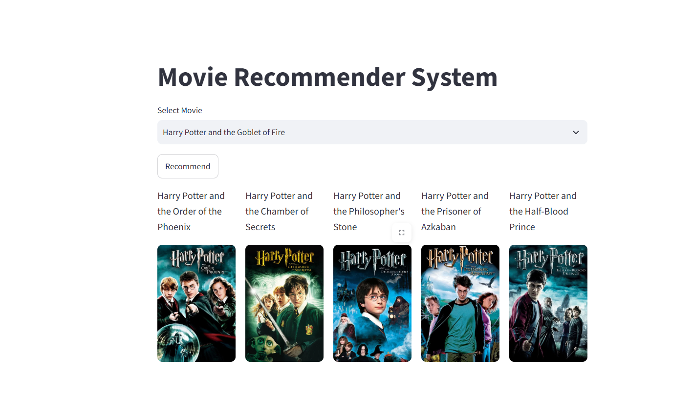

# 🎬 Movie Recommendation System

A content-based movie recommendation system built using Python and machine learning. It recommends five similar movies based on the movie selected by the user.

## 🚀 Live Demo

**Try the application here:**

[🎥 Movie Recommendation System](https://movie-recommendation-system-kjedcsvgrt2rcfcesakyo9.streamlit.app/)
## 📸 Application Screenshot



## ✨ Features

- Select a movie from a dropdown menu.
- Get five similar movie recommendations.
- View movie posters fetched using the TMDB API.
- Interactive web interface built with Streamlit.

## 🛠️ Technologies Used

- Python
- Pandas
- NumPy
- Scikit-learn
- Streamlit
- TMDB API
- Pickle

## ⚙️ How It Works

1. Loads movie data into a Pandas DataFrame.
2. Uses precomputed similarity indices to identify similar movies.
3. Recommends five movies based on the selected movie.
4. Fetches movie posters using the TMDB API.

## 💻 Run Locally

### 1. Clone the repository
```bash
git clone https://github.com/pranjalgour312007/movie-recommendation-system.git
```
